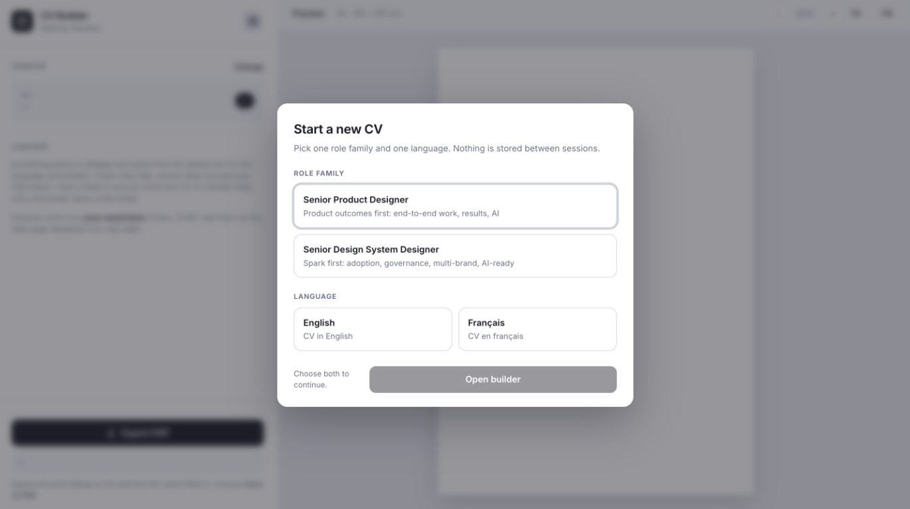

# CV-Builder

A lightweight, browser-based CV builder for creating a focused, one-page A4 résumé. Choose a role family—Product Design or Design Systems—and a language—English or French—then tailor the summary, experience, and other CV content while previewing the result.

## Features

- Live CV preview with page-fit and fill zoom controls.
- Editable sections for experience, education, training, skills, and summary.
- Checks for page overflow, summary length, and new figures.
- A companion CV data editor at [`CV-Data.html`](./CV-Data.html) for reviewing and editing the source text across languages and role families.
- Export to PDF through the browser's print dialog, with A4 sizing and a suggested filename.
- Backup and restore of CV data edits.

## Use

Open [`index.html`](./index.html) in a modern browser, choose a role family and language, and edit the fields in the side panel. Use **Export PDF** to open the print dialog and save the CV as a PDF.

Open **CV data** from the builder to edit the shared source text. Save changes there to make them the builder's defaults; use **Download backup** to keep a copy of those edits.